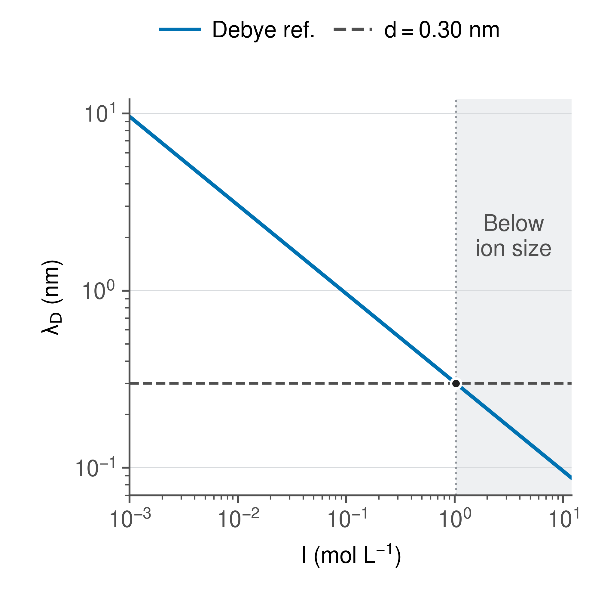
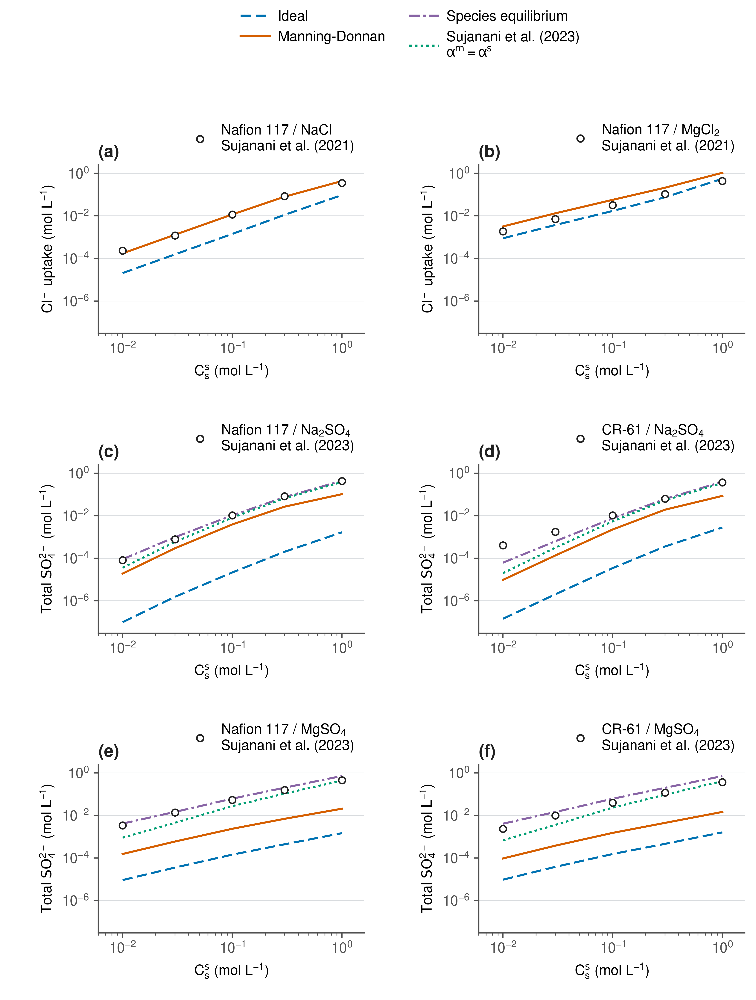
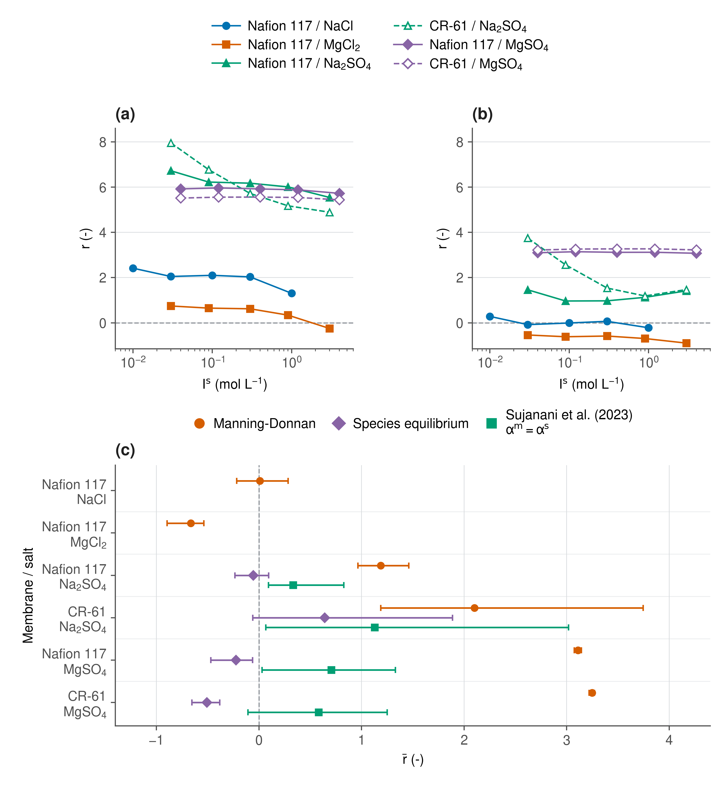
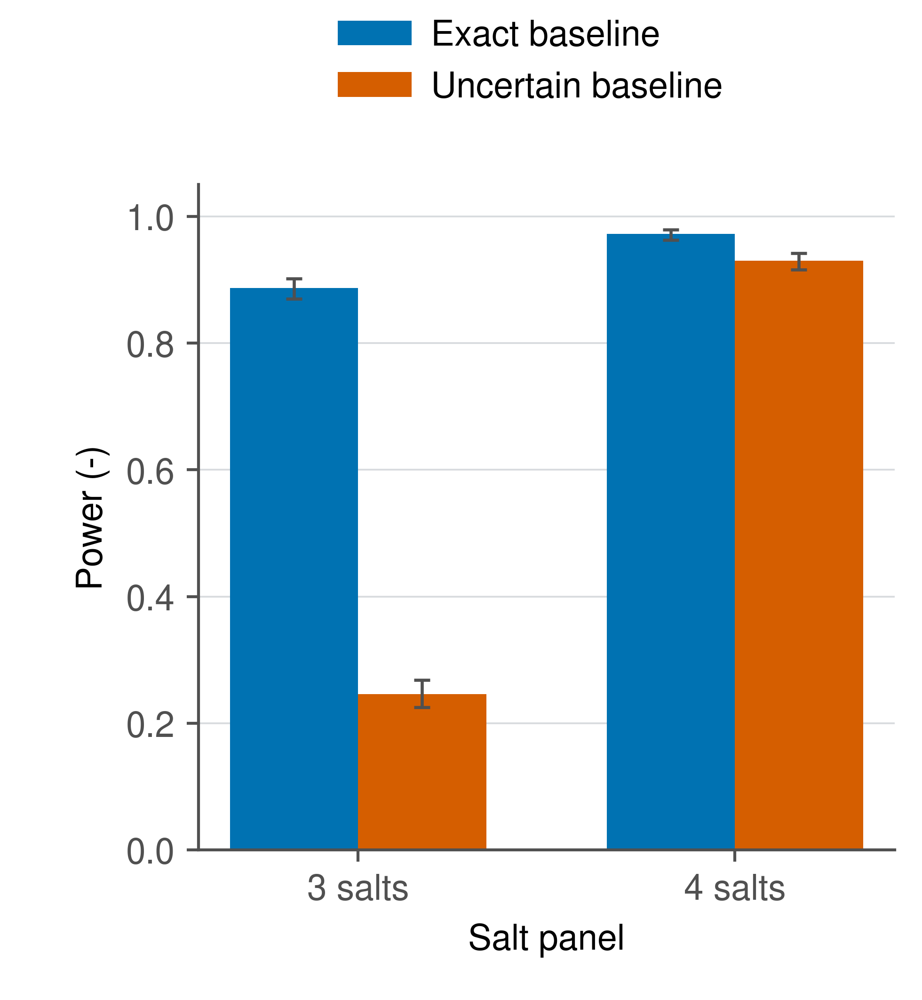
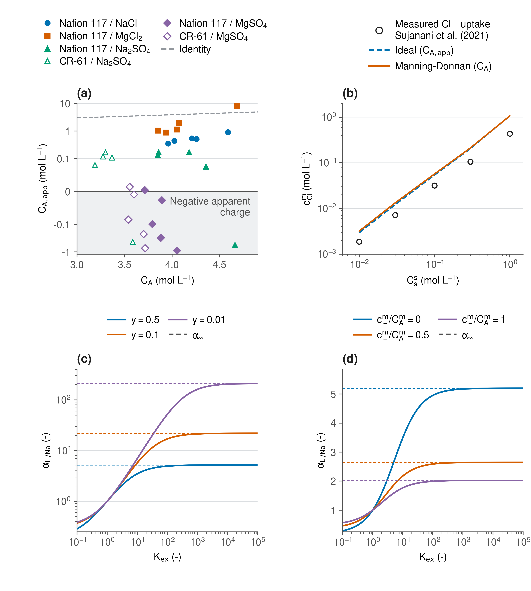

# Donnan membrane partitioning

Equilibrium ion partitioning in charged membranes, with implications for direct
lithium extraction. This repository contains the input data, physical models,
tests, calculated results and five figures.

The calculations cover 30 published single-salt sorption measurements for
Nafion 117 and CR-61. They compare ideal membrane activities, Manning/Donnan,
explicit sulfate species equilibrium and a published weighted association
closure. Further calculations examine charge transferability, mechanism
identifiability and conditional lithium/sodium exchange.

## Reproduce the results and figures

Use Python 3.12. From the repository directory:

```bash
python3.12 -m venv .venv
source .venv/bin/activate
python -m pip install -r requirements-reproduced.txt
bash run_all.sh
```

The run command executes the scientific tests, calculates the equilibrium
predictions and diagnostics, generates the five figures and verifies the
outputs. Numerical results are written to `results/`, figures to `figures/`
and the complete run log to `results/reproduction.log`.

For conda, the equivalent setup is:

```bash
conda env create -f environment.yml
conda activate pccp-dle
bash run_all.sh
```

## Read the outputs

| Output | Contents |
| --- | --- |
| `results/partitioning.csv` | Ideal and Manning predictions for all 30 observations |
| `results/ion_pairing.csv` | Sulfate species, association predictions and equilibrium checks |
| `results/series_summary.csv` | Mean logarithmic residuals for the six membrane/salt series |
| `results/metrics.json` | Overall residuals, ionic-strength ranges and conservation checks |
| `results/validation.csv` | Comparison with published NaCl model predictions |
| `results/identifiability.csv` | Design ranks and prospective simulation power |
| `results/apparent_fixed_charge.csv` | Signed charge values inferred from the ideal model |
| `results/dle_transferability.csv` | NaCl charge calibration transferred to MgCl2 |
| `results/ion_specific_curves.csv` | Conditional lithium/sodium exchange curves |
| `figures/source_data/` | Nine CSV tables containing the plotted values |
| `figures/manifest.json` | Export dimensions, typography and file hashes |
| `results/reproduction_verification.json` | Numerical and figure-export verification |

Residuals are `ln(observed/predicted)`, so positive values mean underprediction.
The overall RMS residuals are 4.93 for ideal membrane activities and 2.14 for
Manning/Donnan. Chloride observations measure co-ion uptake; sulfate observations
measure analytical total uptake, including pairs. The lithium curves and
prospective power calculations use the assumptions documented in
[Model details](docs/MODEL_DETAILS.md).

## Repository layout

| Path | Purpose |
| --- | --- |
| `data/` | Tabulated inputs and [source provenance](data/README.md) |
| `code/hpm/` | Equilibrium, activity, association and exchange models |
| `code/` | Analysis, diagnostics, plotting and verification entry points |
| `tests/` | Conservation, equilibrium, limiting-case, rank and reference checks |
| `results/` | Calculated numerical outputs and summaries |
| `figures/` | PDF, SVG, PNG and TIFF artwork |
| `config/` | Figure dimensions, typography and captions |
| `assets/fonts/` | Bundled plotting fonts and their licence |
| `docs/` | Model equations, [figure definitions](docs/FIGURES.md) and references |

## Individual commands

Run tests:

```bash
python -m unittest discover -s tests -v
```

Regenerate the numerical results:

```bash
python code/analysis.py
python code/dle.py
python code/ion_specific.py
python code/checks.py
```

Generate the figures from those results:

```bash
python code/make_figures.py
python code/verify_outputs.py
```

For a separate preview:

```bash
python code/make_figures.py --formats png --dpi 180 --output-dir preview
```

Figures 1 and 4 have 83 mm canvases; Figures 2, 3 and 5 have 171 mm canvases.
PDF and SVG are vector exports. PNG and TIFF are exported at 600 dpi.
The default font is the bundled Nimbus Sans, with 9 pt axis labels, ticks and
legends. Settings are in `config/figure_style.json`; captions are in
`config/figure_captions.json`.

GitHub Actions runs the tests and reproduction workflow on Linux and macOS.

## Figures

**1. Dilute Debye screening reference**



**2. Chloride and total sulfate sorption**



**3. Logarithmic residuals and series means**



**4. Prospective mechanism-detection power**



**5. Charge transferability and conditional lithium/sodium exchange**



## Citation

Software citation metadata is in `CITATION.cff`. Publication metadata for the
source measurements and model equations is in [References](docs/REFERENCES.md)
and `docs/references.bib`.
